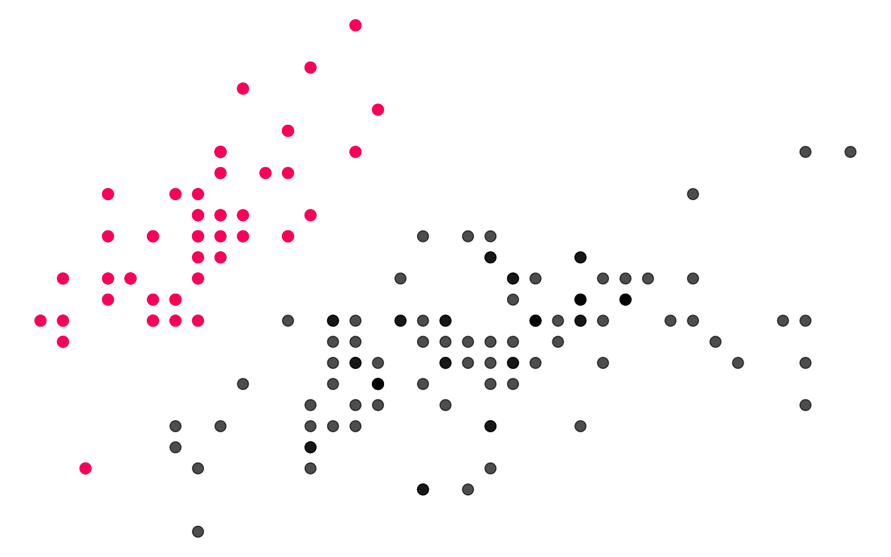
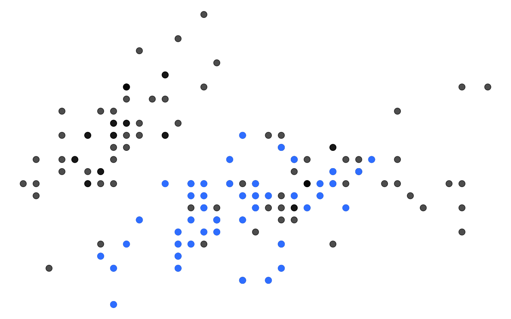
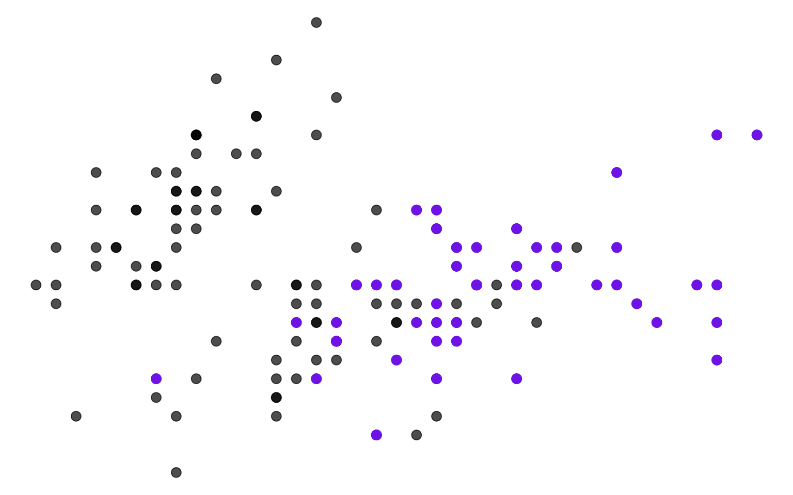

Una de las gracias de generar documentos en Quarto es que podemos combinar la redacción con el código. Pero esto puede ir más allá que simplemente escribir un párrafo de texto y seguido de un párrafo de código. Podemos usar código para literalmente generar texto, títulos y más.

En otros tutoriales vimos cómo podemos [incluir resultados del código dentro de nuestros párrafos de texto](/blog/quarto_reportes/#código-entre-el-texto), por ejemplo, para que una cifra que esté dentro de una oración venga directamente del resultado de un cálculo en vez de tener que escribirle de forma manual. Pero en esta guía vamos a ver cómo podemos programar la generación masiva de títulos, párrafos y gráficos en base a una [iteración, bucle o *loop*.](/blog/r_introduccion/r_intermedio/#bucles)



## Generar contenido del reporte desde loops

Dentro de un *chunk* de código, podemos usar funciones que entreguen como output código markdown. Esto nos servirá para construir un documento a partir de un loop o iteración. De este modo, podemos usar nuestros datos para generar una cantidad indeterminada de títulos, subtítulos, párrafos de textos, gráficos o más, que se generarán automáticamente.

Usaremos el paquete `{pander}` para que el chunk de R retorne contenido en Markdown que Quarto interpretará como parte del documento gracias a la opción `#| results: "asis"` que tenemos que definir al principio del chunk:

``` r
library(dplyr)
library(pander)
```

Como primer ejemplo, tendremos un vector que contiene tres elementos de texto. Para generar el contenido de nuestro documento, queremos generar un título y un párrafo por cada elemento de texto del vector. Entonces, hacemos un loop que vaya iterando por cada elemento del vector, y para cada elemento va a crear un título, un pequeño párrafo, e insertar un emoji:

``` r
animales <- c("gato", "mapache", "castor")

# unir nombres de columnas en un texto
for (animal in animales) {
  
  # crear un título
  pandoc.header(paste("Título:", animal), level = 4)
  
  # crear un párrafo
  pandoc.p(
    paste("Este texto fue generado por `{pander}` dentro de un _for loop_ para el animalito", animal)
  )
  
  # poner un animalito
  pandoc.p(
    case_when(animal == "gato"~ "🐈‍⬛",
              animal == "mapache" ~ "🦝",
              animal == "castor" ~ "🦫")
  )
}
```

#### Título: gato

Este texto fue generado por `{pander}` dentro de un *for loop* para el animalito gato

🐈‍⬛

#### Título: mapache

Este texto fue generado por `{pander}` dentro de un *for loop* para el animalito mapache

🦝

#### Título: castor

Este texto fue generado por `{pander}` dentro de un *for loop* para el animalito castor

🦫

------------------------------------------------------------------------

Como podemos ver, el contenido anterior se generó automáticamente como resultado del loop.

Las funciones `pandoc.header()` y `pandoc.p()` sumadas a la opción `results: asis` nos ayudan a que el chunk retorne texto en markdown. Usando los mismos principios, podemos programar un loop que vaya retornando títulos, textos, y más, para que el contenido del documento se vaya escribiendo solo. Si queremos incluir gráficos, tenemos que imprimirlos explícitamente con `plot()`.

En este segundo ejemplo, iteraremos por los valores de una variable de un dataframe (la variable `Species` de `iris`, que tiene 3 valores posibles) y por cada valor crearemos un título, un gráfico que destaque dicho valor, y un texto que indique una cifra relacionada al valor. Luego del código veremos el contenido resultante, generado de forma automática:

``` r
library(ggplot2)
library(pander)
library(dplyr)
library(glue) # para pegar texto
library(gghighlight) # para destacar valores en gráficos

# iteración
for (especie in unique(iris$Species)) {
  
  # título
  pandoc.header(paste("Especie", especie), level = 3)
  
  # definir color
  color_especie <- case_when(especie == "setosa" ~ "#ff006e",
                             especie == "virginica" ~ "#8338ec",
                             especie == "versicolor" ~ "#3a86ff")
  
  # crear gráfico
  grafico <- iris |> 
    ggplot() +
    aes(x = Sepal.Length, y = Sepal.Width) +
    geom_point(size = 3, color = color_especie) +
    theme_void() +
    gghighlight::gghighlight(Species == especie)
  
  # imprimir gráfico
  plot(grafico)
  
  # crear texto
  largo_petalo <- iris |> 
    filter(Species == especie) |> 
    slice_max(Petal.Length) |> 
    pull(Petal.Length) |> 
    unique()
  
  # imprimir texto
  pandoc.p(
    # paste("La observación más alta en largo de pétalos en la especie", especie, "es:", largo_petalo)
    glue::glue("La observación más alta en largo de pétalos en la especie **{especie}** es: {largo_petalo}")
  )
  
  # línea divisoria
  # pandoc.horizontal.rule()
}
```

### Especie setosa



La observación más alta en largo de pétalos en la especie **setosa** es: 1.9

### Especie versicolor



La observación más alta en largo de pétalos en la especie **versicolor** es: 5.1

### Especie virginica



La observación más alta en largo de pétalos en la especie **virginica** es: 6.9

Si no te funciona, recuerda que el chunk tiene que tener `#| results: "asis"` definido al principio para que el output sea el correcto.

Usando esta técnica podemos producir documentos muy extensos con poco código, lo que nos vuelve más eficientes y también nos ayuda para actualizar y retocar los reportes, dado que un cambio hecho una sola vez se replica en todos los elementos generados por el loop.

Esto puede sernos útil si es que estamos generando un documento en el que estamos presentando resultados y tenemos que repetir varias veces contenido similar para los distintos valores de una variable, o si tenemos que mostrar muchos gráficos similares para distintas variables, etc.



